<h1 align="center">Wazuh SOC Lab</h1>

<p align="center">
  <em>Detecting and responding to attacks on Windows and Linux endpoints with Wazuh, Sysmon, and Tines SOAR</em>
</p>

<p align="center">
  
  
  
  
</p>

---

## Overview

Wazuh SOC Lab is a hands-on security operations project. Simulated attacks run against a Windows and a Linux endpoint. Wazuh collects their telemetry, detects suspicious activity with a custom rule, and triggers an automated response. The response is a Tines SOAR workflow that enriches the alert with threat intelligence and asks an analyst in Slack to approve the block before the attacker is blocked through the Wazuh API.

## Architecture

The lab runs on three virtual machines on the `192.168.160.0/24` network.

| Machine | Role | IP Address | Operating System |
|---------|------|------------|------------------|
| Wazuh Server | SIEM manager, indexer, and dashboard | 192.168.160.137 | Ubuntu |
| Windows Target | Victim endpoint with the Wazuh agent and Sysmon | 192.168.160.136 | Windows 10 |
| Ubuntu Target | Victim endpoint with the Wazuh agent and Sysmon for Linux | 192.168.160.138 | Ubuntu 24.04 |
| Kali Linux | Attacker machine | 192.168.160.139 | Kali Linux |

**Technologies:** Wazuh (SIEM, rules, active response), Sysmon for Windows and Linux, Filebeat, Tines (SOAR), Slack (analyst notifications), AbuseIPDB and VirusTotal (threat intelligence), and ngrok (exposes the on-premises Wazuh API to Tines).

## Wazuh Dashboard and Agents

Both endpoints register as active agents with the Wazuh manager, which receives their telemetry in real time.

<p align="center">
  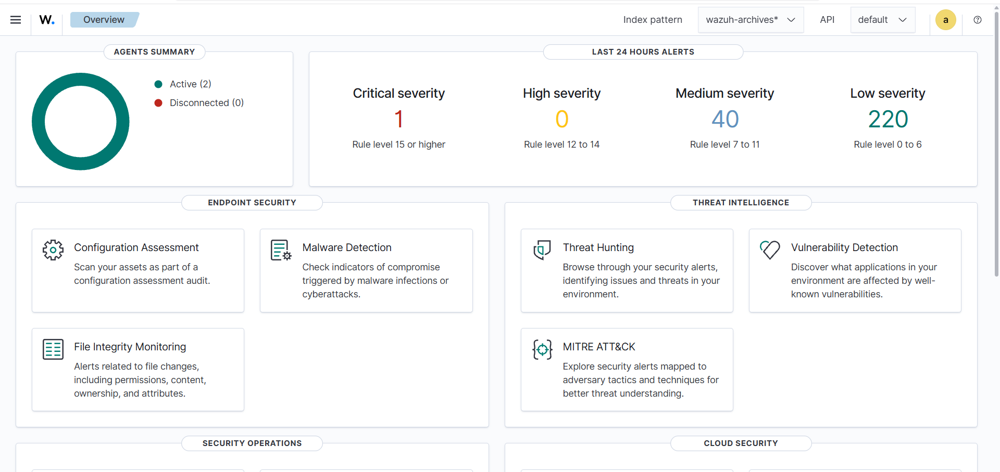
</p>

<p align="center">
  
</p>

## Project Phases

Each phase has its own folder with the commands, logs, and captures for that step.

| # | Phase | Description | Folder |
|---|-------|-------------|--------|
| 1 | Generating Telemetry | Simulated account activity on Windows, SSH brute force and login on Ubuntu, and the events Wazuh recorded | [`01-generating-telemetry/`](01-generating-telemetry/) |
| 2 | Dashboard Creation | Building the Wazuh dashboards that visualize the collected telemetry | [`02-dashboard-creation/`](02-dashboard-creation/) |
| 3 | FIM and Detection | File integrity monitoring on sensitive folders and a custom rule (ID 100101) with active response | [`03-fim-and-detection/`](03-fim-and-detection/) |
| 4 | C2 Setup | Command and control setup and detection | [`04-c2-setup/`](04-c2-setup/) |
| 5 | SOAR | Tines workflow with threat intelligence, analyst approval, and Wazuh API blocking | [`05-soar/`](05-soar/) |

# Phase 1: Generating Telemetry

This phase simulates common activities an attacker might perform after gaining initial access to an environment. Before moving further, an attacker needs to understand the compromised system, identify available accounts, discover network information, and determine which users have administrative privileges.

The objective of this phase is to generate realistic security telemetry on both Windows and Linux endpoints and observe how Wazuh captures these activities.

> **Screenshots:** All captures for this phase are stored in `01-generating-telemetry/`, named `1.png` through `9.png`, plus `6.1.png`.

## 1. Host and Environment Discovery

After compromising a machine, an attacker rarely knows the internal environment. They need to gather information about the host, its network configuration, and available user accounts before deciding what to do next.

On the Windows target, I used the following commands to simulate this discovery activity:

| Command | Attacker's objective |
|---|---|
| `ipconfig /all` | Identify network interfaces, IP addresses, DNS servers, and network configuration. |
| `net user` | Enumerate local user accounts and identify potential targets. |
| `net localgroup administrators` | Identify accounts with administrative privileges. |

**Why this matters:** This information helps an attacker understand the machine's network position, identify privileged accounts, and assess potential opportunities for privilege escalation or lateral movement.


## 2. Account Manipulation

After discovering the available accounts and privileges, I simulated suspicious account manipulation on the Windows endpoint.

The actions included:
- Enabling the built-in Guest account.
- Setting a password for the Guest account.
- Creating a new account named `student1`.
- Adding `student1` to the local Administrators group.
- Deleting the account afterward.

**Attacker's objective:** Creating or modifying accounts and assigning administrative privileges can provide an attacker with an additional way to access and maintain control of a compromised system.

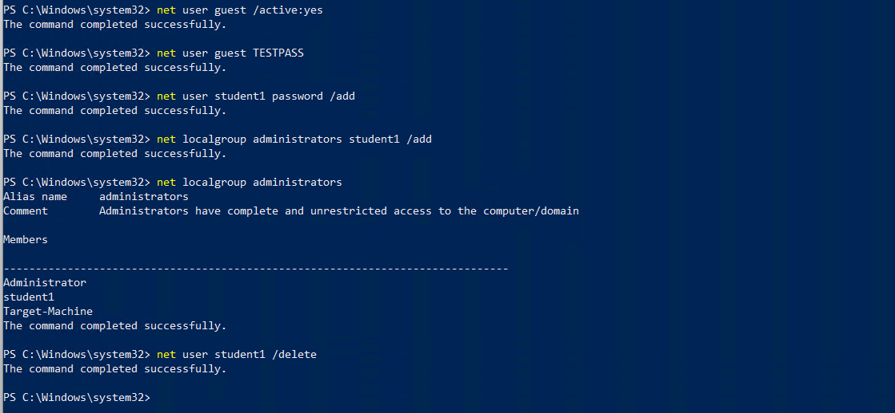

## 3. Windows Event Detection in Wazuh

Wazuh collected the Windows Security events generated by the account manipulation activities.

I examined three important Windows Security Event IDs:

**Event ID 4720 – A user account was created**

Records the creation of the `student1` account. The SID ending in `1002` identifies the newly created account.


**Event ID 4732 – A member was added to a security-enabled local group**

Records the addition of `student1` to the local Administrators group. The Member SID matches the SID observed in Event 4720, linking the two activities to the same account.

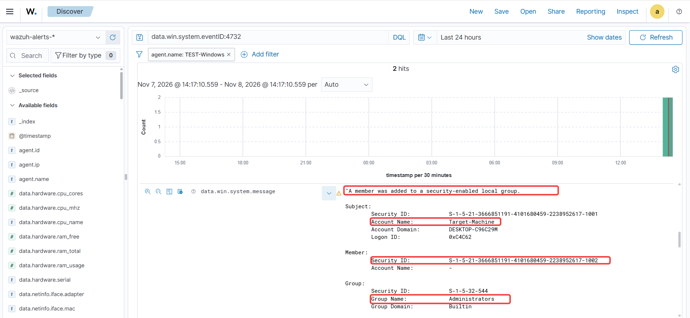

**Event ID 4726 – A user account was deleted**

Records the deletion of the `student1` account, completing the simulated account manipulation sequence.

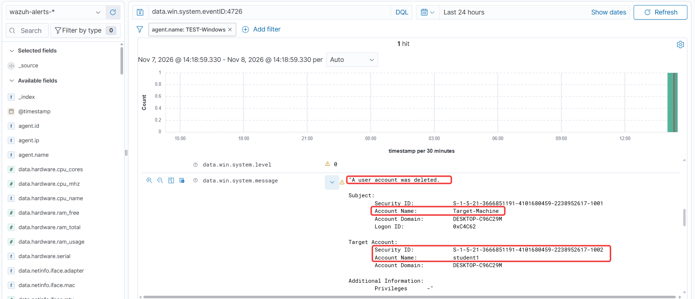

## 4. SSH Authentication Attempts – Linux Endpoint

I then moved to the Ubuntu target to simulate suspicious SSH authentication activity.

First, I attempted to authenticate using `fakeuser1`, a username that does not exist on the system. These attempts were rejected.

I subsequently authenticated using `ahmadou`, a valid local account, and successfully established an SSH session.


**Failed authentication attempts:**

Wazuh recorded the unsuccessful SSH authentication attempts, providing visibility into potential brute-force or username-enumeration activity.

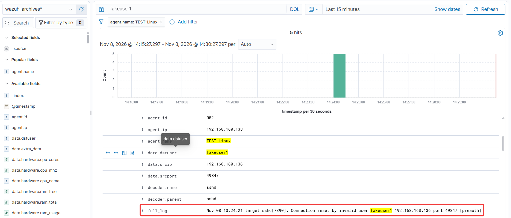

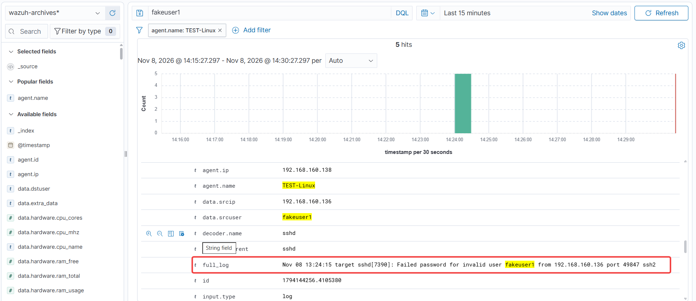

**Successful authentication:**

The subsequent successful login demonstrates why monitoring failed authentication attempts alone is insufficient. A successful authentication following multiple failures can indicate that an attacker eventually obtained valid credentials.

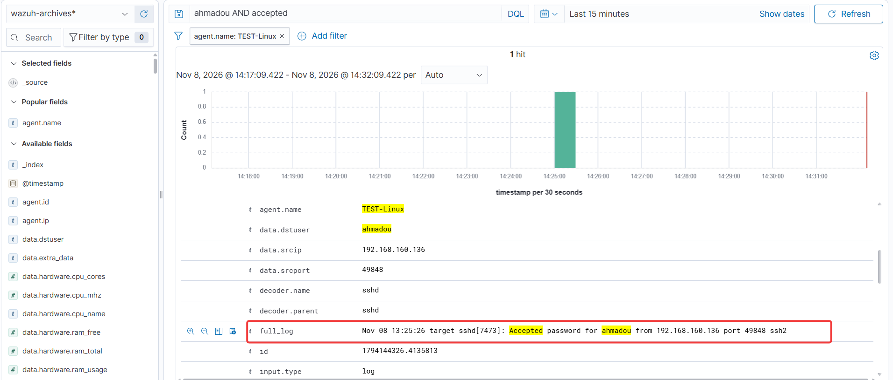

## 5. Security Significance

This phase demonstrates how seemingly ordinary system administration commands and authentication activities can become valuable indicators of compromise when observed in the right context.

The generated telemetry provides the foundation for the next phase: building dashboards to visualize authentication activity, account changes, and suspicious behavior.

More importantly, the failed SSH authentication attempts followed by a successful login establish the scenario used to develop and test a custom detection rule in Phase 3.

## Phase 2: Security Monitoring Dashboard

After generating telemetry on both endpoints, the next step was to build a centralized dashboard in Wazuh to provide visibility into authentication activity and account-related changes.

The objective was to transform raw security events into visual information that an analyst can quickly review to identify suspicious patterns and investigate potentially malicious activity.

### 1. Dashboard Overview

The dashboard contains three main visualizations covering Windows authentication, Windows account management, and Linux SSH authentication activity.

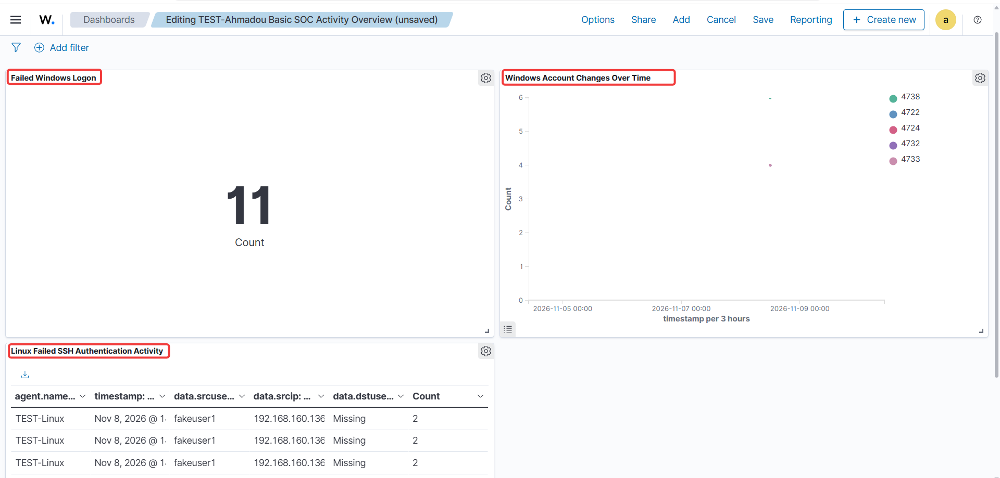

### 2. Windows Failed Logons

**Total failed logons: 11**

This visualization tracks unsuccessful Windows authentication attempts.

Monitoring failed logons helps identify potential password-guessing activity, brute-force attempts, and suspicious authentication patterns.

An analyst can use this information as a starting point to investigate:
- Which accounts are being targeted?
- Are multiple failed attempts coming from the same source?
- Are failures followed by successful authentication?
- Is the activity concentrated within a short period?

### 3. Windows Account Changes Over Time

This visualization tracks account-related security events over time, using a three-hour aggregation interval.

The dashboard monitors the following Windows Security Event IDs:

| Event ID | Description |
|---|---|
| 4738 | A user account was changed |
| 4722 | A user account was enabled |
| 4724 | An attempt was made to reset an account's password |
| 4732 | A member was added to a security-enabled local group |
| 4733 | A member was removed from a security-enabled local group |

Monitoring these events provides visibility into changes that could affect account security and access privileges.

For example, an unexpected account being added to the local Administrators group (Event ID 4732) could indicate an attempt to obtain elevated privileges or establish persistence.

### 4. Linux Failed SSH Authentication Activity

This table provides visibility into unsuccessful SSH authentication attempts collected from the Linux endpoint.

The dashboard displays:
- **Agent:** The endpoint generating the event.
- **Timestamp:** When the authentication attempt occurred.
- **Source user:** The username used during authentication.
- **Source IP:** The IP address associated with the attempt.
- **Destination user:** The destination account, when available.
- **Count:** Number of events grouped together.

In the simulated scenario, multiple failed authentication attempts were generated using the non-existent username `fakeuser1`.

This visualization helps an analyst identify targeted usernames, investigate repeated authentication failures, and identify potential brute-force activity.

### 5. Security Value

The dashboard brings together authentication and account-management telemetry from Windows and Linux endpoints into a single monitoring interface.

Rather than manually reviewing individual events, an analyst can quickly identify unusual activity and use the underlying security events for further investigation.

This phase establishes the monitoring and visualization layer of the lab. The next phase focuses on File Integrity Monitoring (FIM) and custom detection rules to move beyond visibility toward automated detection and response.

## Phase 3: FIM and Detection

After generating telemetry and building the monitoring dashboard, I moved on to implementing detection capabilities and automated response.

In this phase, I configured File Integrity Monitoring (FIM) on both Windows and Linux endpoints, created a custom Wazuh rule to detect repeated SSH authentication failures, and configured Active Response to automatically block the source IP responsible for the suspicious activity.

> **Screenshots:** All captures for this phase are stored in `03-fim-and-detection/`, named `1.png` through `9.png`.

### 1. File Integrity Monitoring (FIM) – Windows Endpoint

I started by configuring FIM on the Windows endpoint to monitor a directory containing potentially sensitive business data.

I created the directory `C:\CompanyData` and added a file named `payroll.txt`.

The objective was to simulate a situation where an attacker modifies or deletes sensitive files after gaining access to a system.


**Testing File Integrity Monitoring**

After creating the file, I modified its contents and then deleted it to generate file integrity events.

Wazuh successfully detected both activities and generated the following alerts:

- **Rule ID 550 (Level 7):** Integrity checksum changed – triggered when the file was modified.
- **Rule ID 553 (Level 7):** File deleted – triggered when the file was removed.

These events demonstrate how FIM can help detect unauthorized modifications or deletion of important files.

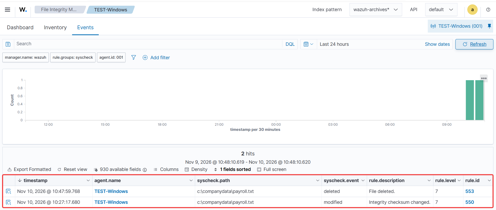

### 2. File Integrity Monitoring (FIM) – Linux Endpoint

I then implemented the same monitoring approach on the Ubuntu endpoint.

I created the directory `/opt/company-data` and a file named `test.txt`.

To configure Wazuh to monitor this directory, I edited the agent configuration file:

```bash
sudo vi /var/ossec/etc/ossec.conf
```

After updating the configuration, I restarted the Wazuh agent:

```bash
sudo systemctl restart wazuh-agent.service
```

To test the configuration, I modified the file by appending new content:

```bash
echo "123" >> /opt/company-data/test.txt
```

Wazuh successfully detected the modification and subsequent deletion of the file, generating the expected FIM alerts:

- **Rule ID 550:** Integrity checksum changed.
- **Rule ID 553:** File deleted.

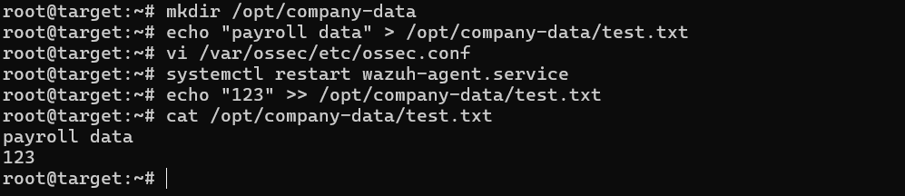


### 3. Creating a Custom SSH Brute-Force Detection Rule

After validating FIM on both endpoints, I moved on to developing a custom detection rule for the SSH authentication activity simulated in Phase 1.

The objective was to detect repeated failed SSH authentication attempts originating from the same source IP address within a short period.

I created a custom rule in Wazuh's `local_rules.xml` configuration file.

**Detection logic:**

| Parameter | Value |
|---|---|
| Rule ID | `100101` |
| Severity | Level 10 – High |
| Parent rule | `5760` |
| Frequency | 3 failed authentication events |
| Timeframe | 120 seconds |
| Source correlation | Same source IP |
| MITRE ATT&CK | T1110 – Brute Force |

**How the rule works:**

- Wazuh first identifies SSH authentication failures matching the built-in rule ID `5760`.
- The correlation condition checks whether the events originate from the same source IP.
- After three matching events within 120 seconds, the custom rule triggers.
- Wazuh generates a Level 10 alert to highlight the suspicious authentication activity.

This allows me to correlate individual failed logins into a higher-level detection rather than treating each authentication failure as an isolated event.

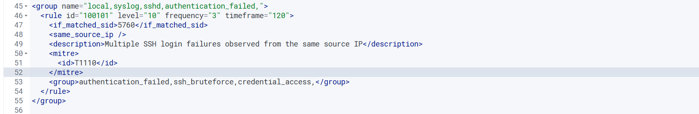

### 4. Simulating SSH Brute-Force Activity, Validating Detection and Response capability

With the custom rule configured, I returned to the Windows machine to simulate repeated SSH authentication failures against the Ubuntu endpoint (`192.168.160.138`).

Using Windows PowerShell, I attempted multiple SSH connections to the Linux machine using the valid username `ahmadou` but incorrect passwords.

As expected, the SSH server rejected the authentication attempts and returned multiple `Permission denied` messages.


**Detection in Wazuh**

I then checked the Wazuh dashboard to verify whether the custom rule had detected the activity.

The rule successfully triggered:

- **Rule ID:** `100101`
- **Severity:** Level 10
- **Description:** Multiple SSH login failures observed from the same source IP.

Shortly afterward, Wazuh's Active Response module executed the `firewall-drop` script and generated another alert:

**Host Blocked by firewall-drop Active Response**

This confirmed that the suspicious authentication activity was not only detected but also triggered an automated response.

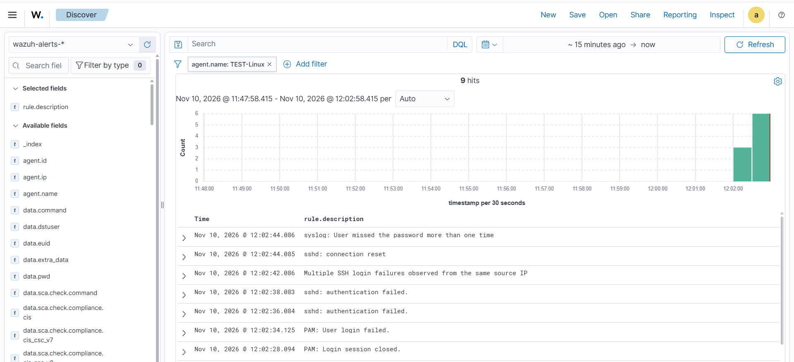

### 5. Verifying the Automated IP Block

To make sure the response was actually applied, I accessed the Ubuntu endpoint and inspected its firewall rules:

```bash
sudo iptables -L -n --line-numbers
```

The output showed that Wazuh had automatically inserted DROP rules into the `INPUT` and `FORWARD` chains.

The source IP address of the Windows machine (`192.168.160.136`) appeared in the blocking rules.

This confirmed that the `firewall-drop` script had successfully modified the endpoint's firewall configuration to block traffic from the offending IP.

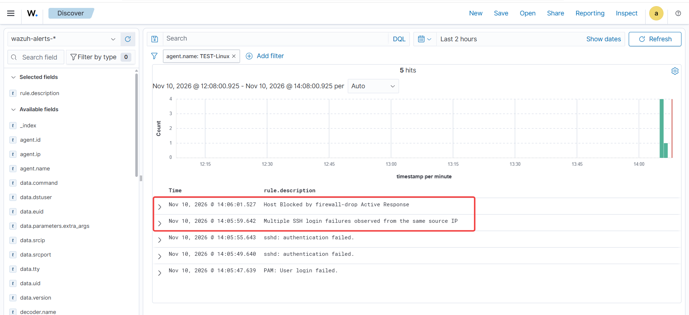

**Cleaning Up the Environment**

After verifying the automated response, I manually removed the temporary firewall rules to restore connectivity:

```bash
sudo iptables -D INPUT 1
sudo iptables -D FORWARD 1
```

### Why It Matters

This phase allowed me to move beyond collecting and visualizing security events and start implementing actual detection and response capabilities.

Through this implementation, I demonstrated three important SOC capabilities:

1. **File Integrity Monitoring:** Detecting unauthorized modifications and deletions of files on Windows and Linux endpoints.
2. **Threat Detection:** Correlating multiple SSH authentication failures from the same source IP using a custom Wazuh rule.
3. **Automated Response:** Using Wazuh Active Response to automatically block the source IP through the endpoint firewall.

The result is a basic detection and response workflow in which suspicious authentication activity can be identified, correlated, and mitigated automatically without requiring an analyst to manually intervene at every step.

In the next phase, I explore Command and Control (C2) activity and how endpoint telemetry can help identify suspicious attacker behavior beyond authentication events.

### Phase 4: C2 Setup
Command and control setup and detection.

### Phase 5: SOAR with Tines
Wazuh sends rule 100101 alerts to Tines through a custom integration. Tines enriches the source IP with AbuseIPDB and VirusTotal, gets a block recommendation from an AI agent, and posts the evidence to Slack. The Wazuh API blocks the attacker only after the analyst approves.

## Repository Structure

```
wazuh-soc-lab/
├── README.md
├── images/                     # Architecture, dashboard, and agent captures
├── 01-generating-telemetry/    # Commands, logs, and captures
├── 02-dashboard-creation/      # Dashboard screenshots and build notes
├── 03-fim-and-detection/       # FIM configuration, custom rule, and active response
├── 04-c2-setup/                # C2 setup and detection
└── 05-soar/                    # Tines workflow, Wazuh integration, and Slack setup
```

## Security Notice

This lab runs on isolated virtual machines for learning. No credentials, API keys, webhook URLs, or tunnel addresses are stored in this repository. Use placeholders such as `<TINES_WEBHOOK_URL>` and keep real secrets in a password manager.

---

<p align="center">
  <sub>Built for hands-on learning in security operations.</sub>
</p>
